# 《从超卖到少卖——4 种秒杀库存方案，我全跑了一遍真实并发》

秒杀怎么防超卖，网上一搜全是文章，翻来覆去就是那几个词：加锁、事务、乐观锁。但到底哪种行、互相差多少，没几个人给过真实数字。正好这几个版本我自己都写了一遍，就顺手拿 JMeter 压了一下，把跑出来的结果和踩到的坑放出来，给大家一个参考。

## 一、超卖到底是如何发生的

我们去秒杀一个商品，要做的事情很简单：查一下剩余库存，够就扣减下单，不够就秒杀失败。逻辑没毛病，那超卖是怎么来的？看这段代码：

```java
// Service 层
// 1. 查询商品
Product product = productMapper.selectById(productId);
// 2. 检查库存
if (product.getStock() <= 0) {
    throw new RuntimeException("库存不足");
}
// 3. 扣减库存
int updateRows = productMapper.decreaseStock(productId);

// Mapper 层
@Update("UPDATE product SET stock = stock - 1 WHERE id = #{id}")
int decreaseStock(@Param("id") Long id);
```

秒杀是多线程并发进来的。100 个线程同时查商品，看到的库存都是 1，于是检查全部通过，然后 100 个一起去扣减。查和扣是两步操作，中间这个窗口谁都挤得进来，超卖就是从这来的。

不过真正的凶手藏在 SQL 里：`WHERE id = #{id}` 后面少了 `stock > 0`，也就是说库存就算已经是负数，这条 UPDATE 也照扣不误。数据库这一层等于没设防。

数据库测试数据：

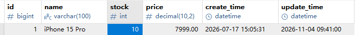

5秒分内启动200线程进行测试：

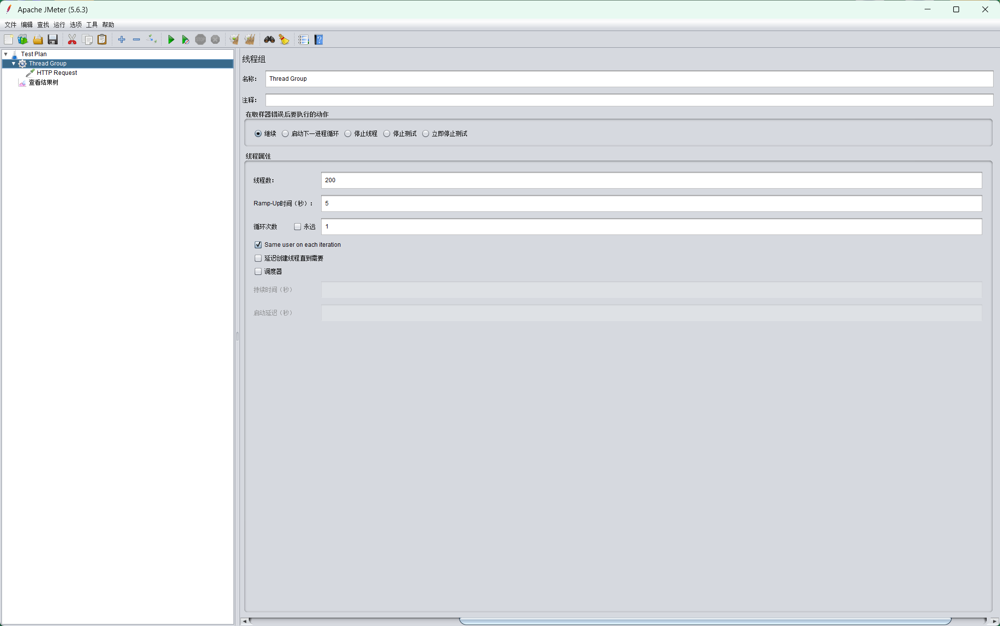

跑完看结果，库存被扣成了负数：

测试后数据：

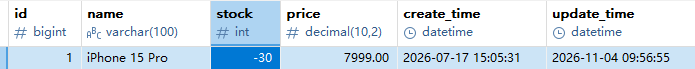

聚合报告：

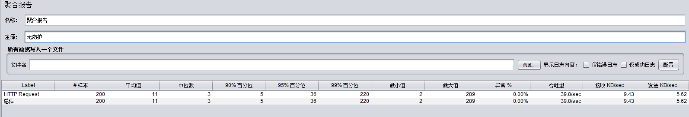


## 二、没想到 MySQL 还有隐式保护

想堵住超卖，其实把扣减那条 SQL 改一下就行：

```java
@Update("UPDATE product SET stock = stock - 1 WHERE id = #{id} AND stock > 0")
int decreaseStock(@Param("id") Long id);
```

判断和扣减在同一条 SQL 里完成，是个原子操作。InnoDB 对同一行的更新是排队执行的，第 1 条把库存扣掉之后，剩下 99 条因为 `stock > 0` 不成立，更新到 0 行，直接失败。查和扣之间没有窗口了，超卖堵死。

但这么干效率上不来。查一次、扣一次都要打 MySQL，2000 个线程就是 4000 次数据库操作，真要只卖 10 个商品，剩下的全是无效请求，压力全压在 MySQL 身上。压一轮能看出来不超卖了，但速度并不好看：

测试前数据：10个库存，利用5秒时间启动200个线程抢购。

测试后数据：

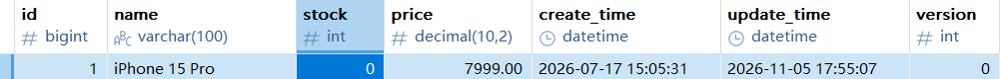

聚合报告：

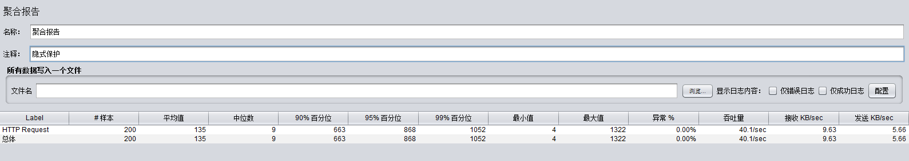


## 三、@Transactional + 悲观锁

先说个常见误区：光加 `@Transactional` 是没用的。它保证的是"要么全成功要么全回滚"，挡不住并发读，两个事务照样同时读到 stock=1。我单独压了只加事务的版本，结果跟方案一差不多，还是超卖：

（贴图：只加 @Transactional 的压测结果）

所以事务得配着悲观锁一起用：

```java
@Override
@Transactional
public Order seckillV3悲观锁(Long productId, Long userId) {
    // SELECT ... FOR UPDATE 对这一行加锁，其他线程的操作会被挡住。
    // 注意必须配 @Transactional，不然这行代码一执行完，锁就释放了
    Product product = productMapper.selectByIdForUpdate(productId); // 加的是行锁，不是表锁

    // 检查库存、扣减、生成订单，都走不到锁外
    // ...
    // 事务提交时释放锁
}

// Mapper 层
@Select("SELECT * FROM product WHERE id = #{id} FOR UPDATE")
Product selectByIdForUpdate(@Param("id") Long id);
```

说白了，就是查询的时候把这一行锁住。其他线程想动 id=1 这行就得排队，等拿锁的线程提交事务释放锁，大家再接着抢。同一行的操作排成了一队，超卖自然就没了。

代价也很直白：所有人串行，性能上不去。压测里它是最慢的，耗时比方案一长了一大截：

测试前数据：10个库存，利用5秒时间启动200个线程抢购。

测试后数据：

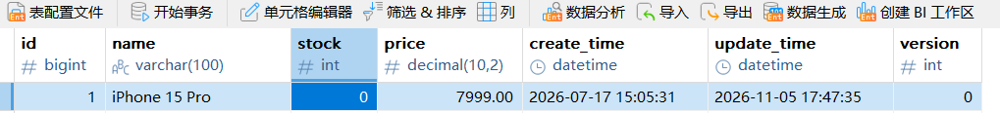

不会出现超卖。

聚合数据：

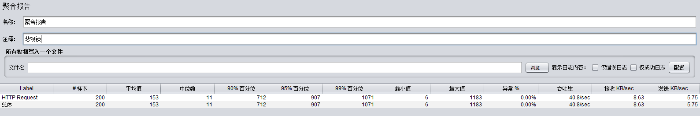


## 四、乐观锁，和它带来的"少卖"

乐观锁要给商品表加个 version 字段，更新的时候比对版本号：

```sql
ALTER TABLE product ADD COLUMN version INT NOT NULL DEFAULT 0;
```

```java
public Order seckillV4乐观锁(Long productId, Long userId) {
    int maxRetry = 3;
    for (int i = 0; i < maxRetry; i++) {
        Product product = productMapper.selectById(productId);
        // ...
        int updateRows = productMapper.decreaseStockByVersion(productId, product.getVersion());
        if (updateRows > 0) {
            // 扣减成功，生成订单，返回
        }
        Thread.sleep(10); // 版本冲突了，歇会再试
    }
    throw new RuntimeException("秒杀失败，请重试"); // 3 次都没抢到
}
```

```java
@Update("UPDATE product SET stock = stock - 1, version = version + 1 WHERE id = #{id} AND version = #{version}")
int decreaseStockByVersion(@Param("id") Long id, @Param("version") Integer version);
```

整个过程不加锁，靠版本号兜底：扣减那一刻 version 还是我读到的值才生效，被人改过就说明这单已经被抢了，重读再试，最多试 3 次。

但这次压测撞出来一个反方向的问题。跑完看数据我愣了一下，库存居然没卖完：

测试前数据：10个库存，利用5秒时间启动200个线程抢购。

测试后数据：

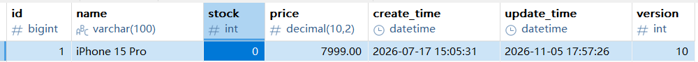

聚合报告：

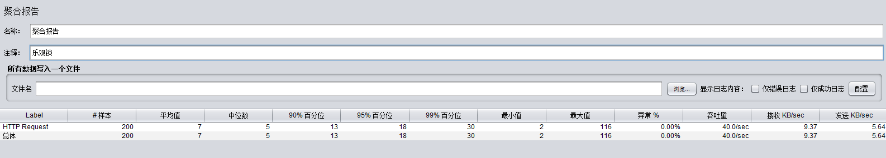


按理说这么多线程抢，库存应该秒光才对，结果只卖出去一部分，剩下的就一直剩着。而且失败的那批收到的不是"库存不足"，是"秒杀失败，请重试"——可库存明明还有，用户再点几次也轮不到他。

原因梳理一下就清楚了，请求基本是一波一波来的：

1. 200 个线程同时读到 version=0，一起提交扣减。MySQL 对同一行排队执行，第 1 个把 version 改成 1，剩下 199 个的 `WHERE version=0` 扑空，全部白给；
2. 失败的线程睡 10ms 后几乎同时醒来，重读到 version=1，又是一轮齐射，还是只活一个；
3. 三波打完，所有人的 3 次机会用光，散场。

拿 5 个库存举例，最后往往就卖掉 3 个上下，剩下的烂在手里。这跟线程手快手慢没关系，每一波活下来的那个基本是随机的，纯看谁的 UPDATE 先被 MySQL 执行到。

超卖是卖多了，账面上立刻就看出来；少卖是卖少了，表面看着一切正常。这就是标题里的"少卖"。


## 五、少卖测试

测试数据

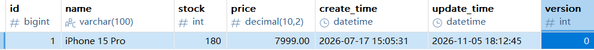

2秒启动200线程抢购

隐式保护和悲观锁库存：

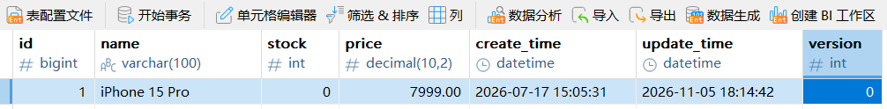

隐式保护和悲观锁都是串行处理数据的但是唯一的好处就是不会少买。

乐观锁库存：

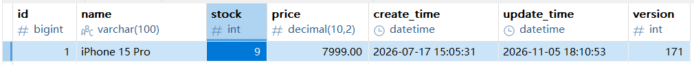


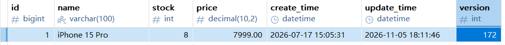

测了两次都是还剩库存的，按道理200人应该抢完180个库存才对，所以乐观锁会少卖。


## 六、总结

| 方案                      | 样本数 | 平均响应 (ms) | 中位数 (ms) | 95% 分位 (ms) | 99% 分位 (ms) | 最大 (ms) | 吞吐量 (req/s) | 超卖风险   |
| ------------------------- | ------ | ------------- | ----------- | ------------- | ------------- | --------- | -------------- | ---------- |
| **无保护（无锁）**        | 200    | 11            | 3           | 36            | 220           | —         | 39.8           | ⚠️ 严重超卖 |
| **隐式锁 (synchronized)** | 200    | 135           | 9           | 868           | 1052          | —         | 40.1           | ✅ 不超卖   |
| **数据库悲观锁**          | 200    | 153           | 11          | 907           | 1071          | —         | 40.8           | ✅ 不超卖   |
| **乐观锁 (版本号)**       | 200    | 7             | 5           | 18            | 30            | 116       | 400            | ✅ 不超卖   |

这一圈试下来，三种修复方案没有一个是白拿的：隐式保护把无效请求全砸在 MySQL 上；悲观锁用串行换正确性，慢；乐观锁不超卖，可它会少卖，库存还在就把用户挡回去了。哪个能用，得看业务能接受哪种损失。

另外这几个方案的操作压力全在 MySQL 上，真高并发是扛不住的。下一步就是上 Redis 预扣减 + MQ 削峰，把无效请求挡在 MySQL 外面，实测放下一篇。

